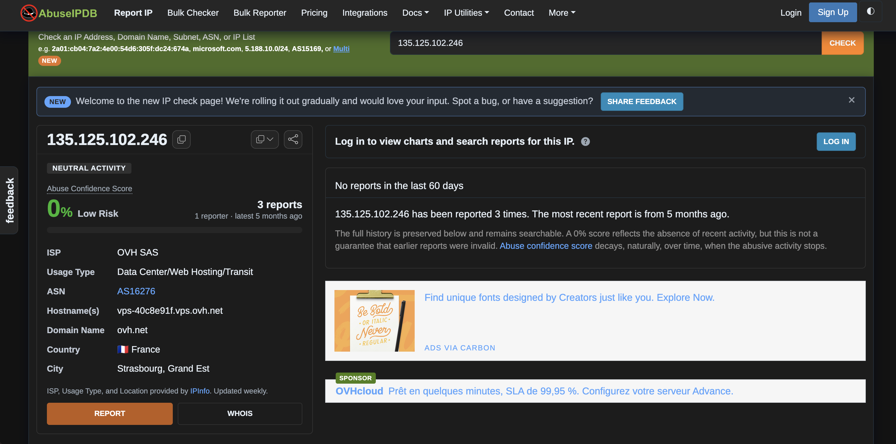
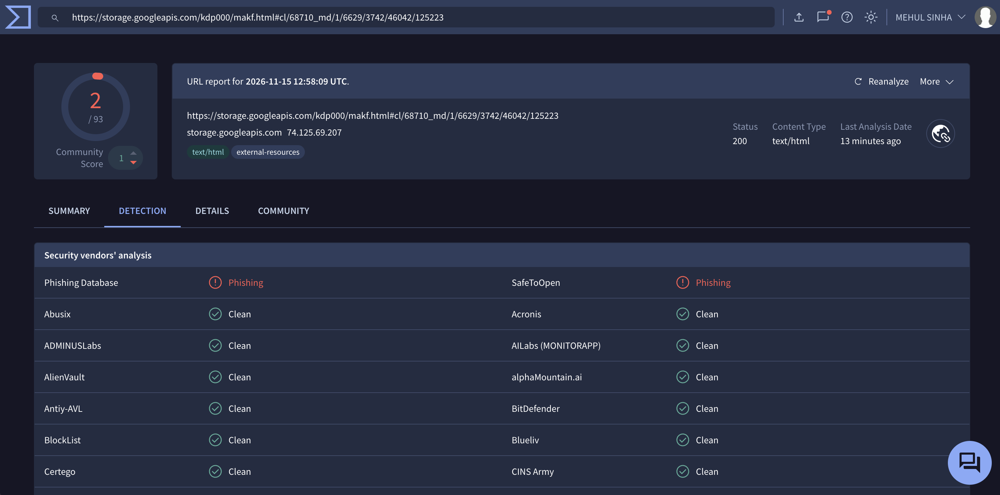
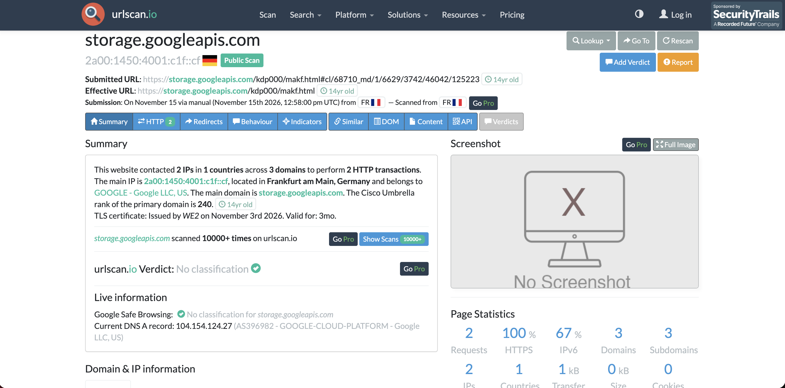
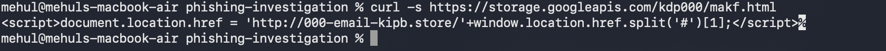
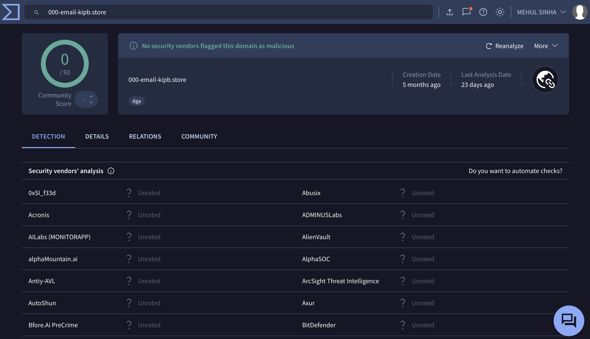
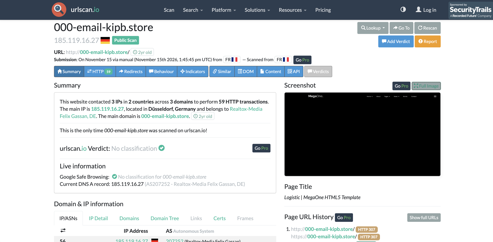

# Case 01 – Fake "account locked" cloud-storage warning with a Google-hosted redirector

**Date analysed:** 2026-11-15   **Analyst:** Mehul Sinha
**Verdict:** Malicious (phishing)   **Severity:** Medium

## 1. Summary
An email received on 13 Nov 2026 claims the recipient's account is locked and that photos and videos will be lost unless they "renew for free today". The link points to a page on Google Cloud Storage that contains a single line of JavaScript, which forwards the victim to a second, unrelated domain. Almost every scanner rated both links as clean, so the verdict rests on the header analysis and on reading the page code.

## 2. Header analysis
| Field | Value | Observation |
|---|---|---|
| From | `<recipient's username>™ <contact@125223ubJQO[.]us>` | Display name copies the recipient's own username to look personal. The real address is a random-looking domain. |
| Return-Path | `return+<recipient>@livesight[.]net` | Different domain from the From address. |
| Subject | "Urgent Warning! Your account has been locked. Save your photos & videos before Fri, 13 Nov 2026 17:10:20 +0100. Renew for free today!" | Urgency and fear. The "deadline" is the exact second the email was sent. |
| Date | Fri, 13 Nov 2026 17:10:20 +0100 | |
| Sending IP | `135.125.102.246` | The only server Google actually saw (from the SPF line). |
| Message-ID | `...smtpin_added_broken@mx.google.com` | The sender did not set a valid Message-ID, so Google added one. Typical of bulk-mailing tools. |
| Delivered-To | `me@gmail.com` | Not the real recipient. A leftover from the sender's template. |

### Authentication results
| Check | Result | Meaning |
|---|---|---|
| SPF | pass, for `livesight[.]net` | The server was allowed to send for the hidden Return-Path domain, not for the From domain the reader sees. |
| DKIM | none | The message was not signed. |
| DMARC | none recorded | No alignment check for the visible From domain. |

**Key point:** an SPF pass does not mean the email is honest. Here it passed for a domain the recipient never sees.

### Received chain
Two lower `Received` lines mention `sailthru.com` and `efianalytics.com` (216.244.76.116). They sit below Google's own stamp, so the sender wrote them and they cannot be trusted. One has an unbalanced bracket. They are most likely there to make the email look as if it came through a known mailing service.

### Sending IP reputation (AbuseIPDB)
`135.125.102.246`: OVH SAS, AS16276, hostname `vps-40c8e91f.vps.ovh[.]net`, data centre in Strasbourg, France. Abuse score 0%, but 3 earlier reports, the latest 5 months ago. It is a rented virtual server, not the mail system of any known brand.

## 3. Social engineering
- Lure: fake cloud-storage warning (account locked, photos and videos at risk).
- Pressure: "Urgent", a deadline, and "free" renewal.
- Personalisation: the recipient's own username in the sender name and in the Return-Path.

## 4. URLs (defanged)
| URL | Role | VirusTotal | urlscan.io |
|---|---|---|---|
| `hxxps://storage.googleapis[.]com/kdp000/makf.html#cl/68710_md/1/6629/3742/46042/125223` | Main link ("cl" = click) | 2/93 (Phishing Database, SafeToOpen) | Scan returned a 400 error page. Page content not captured. |
| `hxxps://storage.googleapis[.]com/kdp000/makf.html#oop/...` | Second link, probably a fake unsubscribe | Same page | |
| `hxxp://dccomics[.]com/LEAVE=To` | Unrelated real site, used as filler | | |
| `hxxp://000-email-kipb[.]store/` | Redirect destination (see below) | 0/92, tagged "dga" | Shows a generic "MegaOne HTML5 Template" site |

### The redirector
Downloading the Google-hosted page as text (`curl`, nothing executed) shows its entire content:

```html
<script>document.location.href = 'http://000-email-kipb.store/'+window.location.href.split('#')[1];</script>
```

It takes everything after the `#` in the link and appends it to a new address. A victim who clicks is sent to:

`hxxp://000-email-kipb[.]store/cl/68710_md/1/6629/3742/46042/125223`

Why this works for the attacker:
- The email only contains a `storage.googleapis.com` address, which filters and people tend to trust. The real destination never appears in the email.
- The part after `#` is not sent to the web server, so a scanner that fetches the page sees one short line and little else.
- The tracking numbers are passed along. The last one, `125223`, matches the sender domain `125223ubJQO[.]us`, which ties the email and the link to the same campaign.

### The destination domain
`000-email-kipb[.]store`: registered about 5 months ago according to VirusTotal (urlscan shows a different age label, so the exact date should be confirmed with a WHOIS lookup). VirusTotal tags it "dga", meaning the name looks machine-generated. It resolves to `185.119.16.27` (AS207252, Realtox-Media, Düsseldorf, Germany). The home page shows an unmodified website template, which looks like a decoy front.

## 5. Attachments
None.

## 6. Indicators of Compromise (IOCs)
- Sender domain: `125223ubJQO[.]us`
- Return-Path domain: `livesight[.]net`
- Sending IP: `135.125.102.246`
- Redirector: `storage.googleapis[.]com/kdp000/makf.html` (bucket `kdp000`)
- Destination domain: `000-email-kipb[.]store`
- Destination IP: `185.119.16.27`

## 7. MITRE ATT&CK
- T1566.002 Phishing: Spearphishing Link
- T1204.001 User Execution: Malicious Link
- T1583.001 Acquire Infrastructure: Domains
- T1583.006 Acquire Infrastructure: Web Services (Google Cloud Storage used to host the redirector)

## 8. Recommended actions
- Block `000-email-kipb[.]store`, `125223ubJQO[.]us` and `livesight[.]net` at the email gateway and web proxy.
- Block the specific path `storage.googleapis[.]com/kdp000/`. The whole Google domain cannot be blocked without breaking legitimate services.
- Search mailboxes for the same subject, sender domain or bucket name and remove any copies.
- If a user clicked: check proxy logs for connections to `000-email-kipb[.]store`, reset their password and review recent sign-ins.
- Report the bucket to Google Cloud abuse and the sending server to OVH abuse.

## 9. Limitations
- The final page behind the tracking path was not opened or scanned, so what the victim is asked to do there (enter card details, log in, install something) was not observed.
- The email body was not reviewed in detail. The analysis is based on the headers, the links and the redirector code.

## 10. Lessons learned
- Reputation scores alone would have cleared this email: 2/93 for the link and 0/92 for the destination.
- SPF passed, but for a domain the reader never sees. Authentication results need to be read against the visible From address.
- Trusted cloud hosting can hide the real destination. Reading the page source revealed it in one line.

## 11. Evidence

**Sending IP on AbuseIPDB**


**Google-hosted link on VirusTotal (2/93)**


**Google-hosted link on urlscan.io**


**Redirect script found with curl**


**Destination domain on VirusTotal (0/92)**


**Destination home page on urlscan.io**

