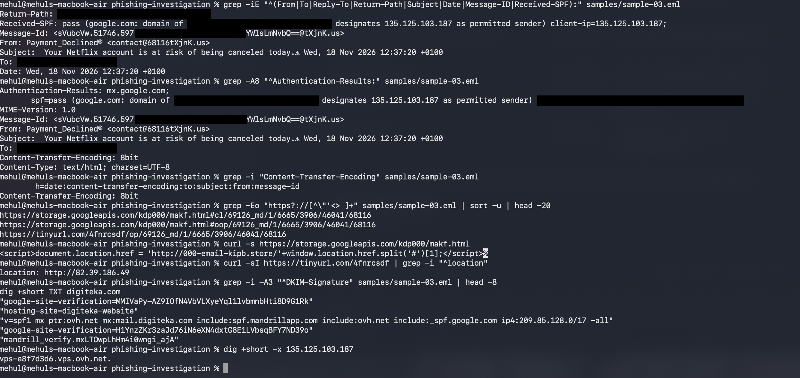
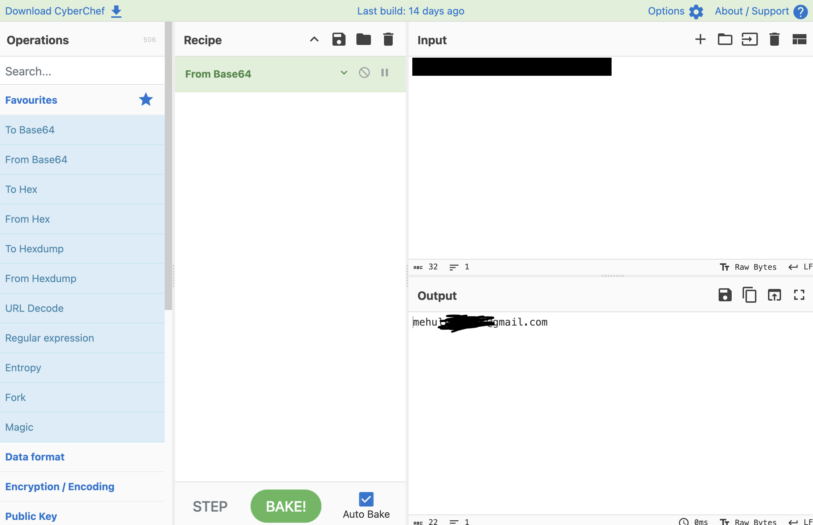
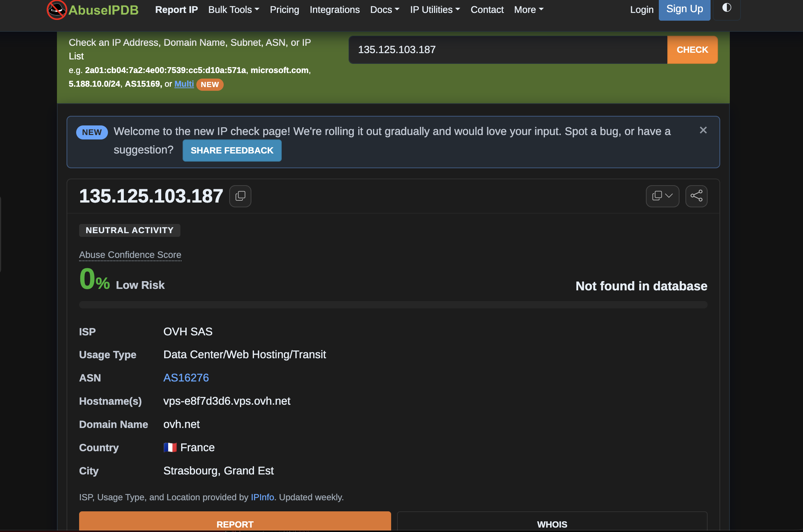
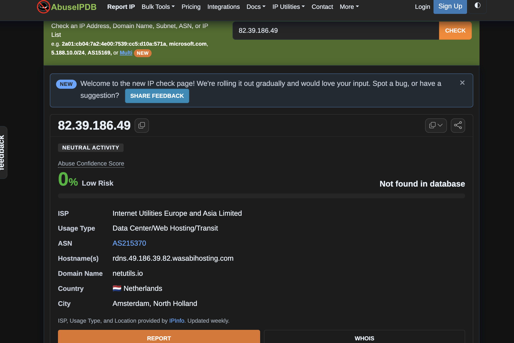
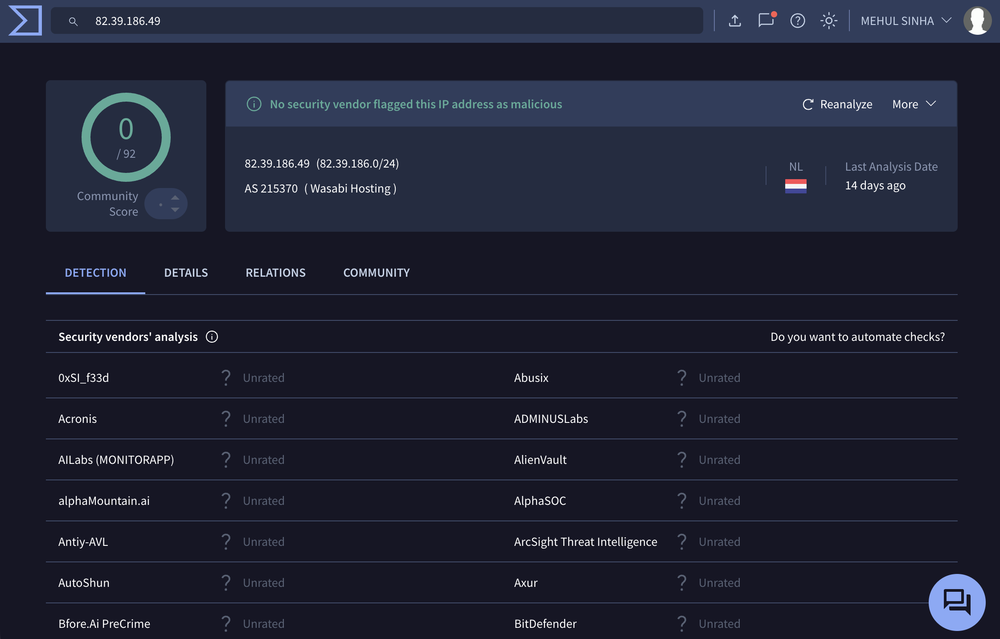

# Case 03 – Fake Netflix "payment declined" email from the same campaign as case 01

**Date analysed:** 2026-11-19   **Analyst:** Mehul Sinha
**Verdict:** Malicious (phishing)   **Severity:** Medium

## 1. Summary
An email received on 18 Nov 2026 claims the recipient's Netflix account will be cancelled today because a payment was declined. Its link points to the exact Google Cloud Storage redirector analysed in case 01, which still forwarded victims to `000-email-kipb[.]store`, and the email follows the same header pattern as case 01. Both emails therefore most likely come from the same campaign, sent five days apart with a different brand. The email passed SPF because the hidden sender domain, belonging to a real company, authorises every server on OVH's network, and the scammers sent it from a rented OVH server.

## 2. Header analysis
| Field | Value | Observation |
|---|---|---|
| From | `Payment_Declined® <contact@68116tXjnK[.]us>` | No Netflix address. Random domain made of a number and letters, the same pattern as case 01 (`125223ubJQO[.]us`). |
| Return-Path | `return+<victim>@digiteka[.]com` | A different domain, and apparently a real company (see SPF below). |
| Subject | "Your Netflix account is at risk of being canceled today. ⚠ Wed, 18 Nov 2026 12:37:20 +0100" | Fear and urgency, with the send time appended, as in case 01. |
| Date | Wed, 18 Nov 2026 12:37:20 +0100 | |
| Message-Id | `<sVubcVw.51746.597.NDD-<base64>@tXjnK[.]us>` | The Base64 part decodes to the recipient's own email address (see below). |
| Sending IP | `135.125.103.187` | Reverse DNS: `vps-e8f7d3d6.vps.ovh[.]net`. |

### Authentication results
| Check | Result | Meaning |
|---|---|---|
| SPF | pass, for `digiteka[.]com` | Passed for the hidden Return-Path domain only, not for the visible sender. |
| DKIM | none | No DKIM-Signature header from the sender. |
| DMARC | none recorded | No alignment check for the visible From domain. |

### Why SPF passed
The SPF record of `digiteka[.]com` (retrieved with `dig TXT`):

```
v=spf1 mx ptr:ovh.net mx:mail.digiteka.com include:spf.mandrillapp.com include:ovh.net include:_spf.google.com ip4:209.85.128.0/17 -all
```

`ptr:ovh.net` allows any server whose reverse DNS name ends in `ovh.net` to send mail as this domain. The sending IP resolves to `vps-e8f7d3d6.vps.ovh.net`, a rented OVH virtual server, so it passes automatically. No compromise of digiteka is needed to explain the result: an overly broad SPF record at a legitimate company let a stranger's server pass the check.

### Sending IP reputation (AbuseIPDB)
`135.125.103.187`: OVH SAS (AS16276), Strasbourg, France, hostname `vps-e8f7d3d6.vps.ovh[.]net`. 0%, not found in the database. The case 01 sender was a neighbouring OVH VPS (`135.125.102.246`, `vps-40c8e91f.vps.ovh[.]net`).

### Recipient tracking in the Message-Id
The Base64 string inside the Message-Id decodes (CyberChef, From Base64) to the recipient's own email address. The sender embeds each recipient's address in the message ID, which lets them track exactly who received which email.

## 3. Social engineering
- Lure: a declined payment and imminent cancellation of a popular subscription.
- Pressure: "today", a warning symbol and the exact time in the subject.
- The sender name "Payment_Declined®" plays on the message rather than claiming to be Netflix directly.

## 4. URLs (defanged)
| URL | Role | Finding |
|---|---|---|
| `hxxps://storage.googleapis[.]com/kdp000/makf.html#cl/69126_md/1/6665/3906/46041/68116` | Main link | Same redirector as case 01 |
| `hxxps://storage.googleapis[.]com/kdp000/makf.html#oop/...` | Second link, probably a fake unsubscribe | Same page |
| `hxxps://tinyurl[.]com/4fnrcsdf/op/...` | Shortened link, probably the opt-out link | Redirects to `hxxp://82.39.186.49` |

### The redirector (unchanged since case 01)
Fetched as text with `curl` on 19 Nov 2026:

```html
<script>document.location.href = 'http://000-email-kipb.store/'+window.location.href.split('#')[1];</script>
```

The page was still live and still pointed to `000-email-kipb[.]store` six days after the case 01 email. The last number in the tracking path (`68116`) matches the number in the sender domain (`68116tXjnK[.]us`), exactly as `125223` did in case 01.

### The TinyURL destination
A HEAD request to TinyURL (`curl -sI`, destination not visited) returned `location: http://82.39.186.49`, again a bare IP address.

`82.39.186.49`: Internet Utilities Europe and Asia Limited / Wasabi Hosting (AS215370), Amsterdam, Netherlands, hostname `rdns.49.186.39.82.wasabihosting[.]com`. AbuseIPDB: 0%, not found. VirusTotal: 0/92.

## 5. Link with case 01
| | Case 01 | Case 03 |
|---|---|---|
| Sender pattern | `contact@125223ubJQO[.]us` | `contact@68116tXjnK[.]us` |
| Return-Path pattern | `return+<victim>@livesight[.]net` | `return+<victim>@digiteka[.]com` |
| Sending server | OVH VPS `135.125.102.246` | OVH VPS `135.125.103.187` |
| Redirector | `storage.googleapis[.]com/kdp000/makf.html` | Same page |
| Final destination | `000-email-kipb[.]store` | Same domain |
| Subject style | Fear + timestamp | Fear + timestamp |

Conclusion: same campaign, different brand (cloud storage, then Netflix).

## 6. Attachments
None.

## 7. Indicators of Compromise (IOCs)
- Sender domain: `68116tXjnK[.]us` (Message-Id domain `tXjnK[.]us`)
- Return-Path domain: `digiteka[.]com` (legitimate domain abused through its SPF record)
- Sending IP: `135.125.103.187`
- Redirector: `storage.googleapis[.]com/kdp000/makf.html`
- Destination domain: `000-email-kipb[.]store`
- Short link: `tinyurl[.]com/4fnrcsdf` → `82.39.186.49`

## 8. MITRE ATT&CK
- T1566.002 Phishing: Spearphishing Link
- T1204.001 User Execution: Malicious Link
- T1583.003 Acquire Infrastructure: Virtual Private Server (rented OVH servers)
- T1583.006 Acquire Infrastructure: Web Services (Google Cloud Storage redirector, TinyURL)
- T1036 Masquerading (Netflix payment theme)

## 9. Recommended actions
- Block `000-email-kipb[.]store`, `82.39.186.49` and the path `storage.googleapis[.]com/kdp000/`.
- Add a gateway rule for the campaign pattern: senders matching `contact@<digits><letters>.us` with a different Return-Path domain.
- Search mailboxes for "Payment_Declined" and the subject, and for other emails linking to `kdp000/makf.html`.
- Report the redirector to Google Cloud abuse (still active after six days) and the TinyURL link to TinyURL.
- Notify digiteka that its SPF record (`ptr:ovh.net`, `include:ovh.net`) lets any OVH server send mail as its domain.

## 10. Limitations
- The final pages at `000-email-kipb[.]store` and `82.39.186.49` were not visited.
- The link between cases 01 and 03 is based on matching infrastructure and patterns, not on confirmed attribution.
- `ptr:ovh.net` is the most likely reason SPF passed; the exact SPF mechanism that matched is not shown in the email headers.

## 11. Lessons learned
- Correlating alerts matters: on its own this was one more phishing email; compared with case 01, it is a repeat of the same campaign with a new brand.
- An SPF pass can come from a legitimate company's overly broad SPF record, not just from the attacker's own domain.
- Tracking data can hide in unexpected places, such as a Base64-encoded email address inside the Message-Id.
- URL shorteners are another way to hide the real destination; a HEAD request reveals it without visiting it.

## 12. Evidence

**Terminal: headers, redirector, TinyURL destination, SPF record and reverse DNS**


**Message-Id decoded in CyberChef (address redacted)**


**Sending IP on AbuseIPDB**


**TinyURL destination on AbuseIPDB**


**TinyURL destination on VirusTotal (0/92)**

