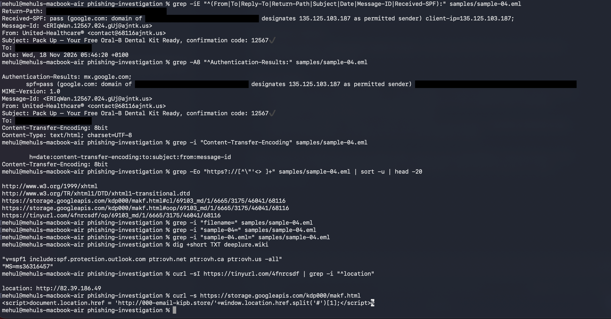
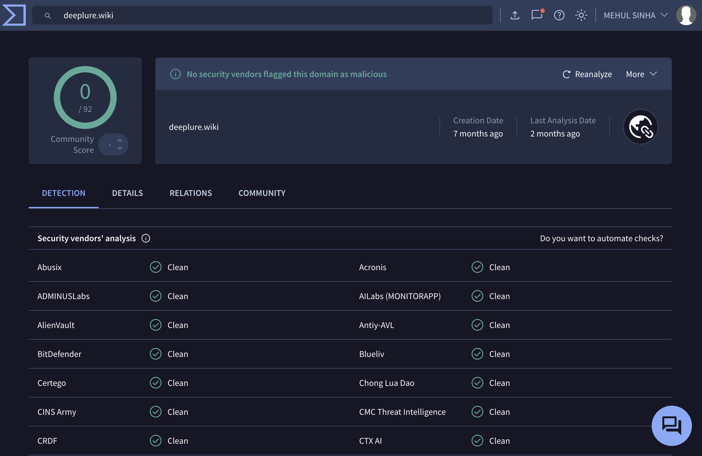
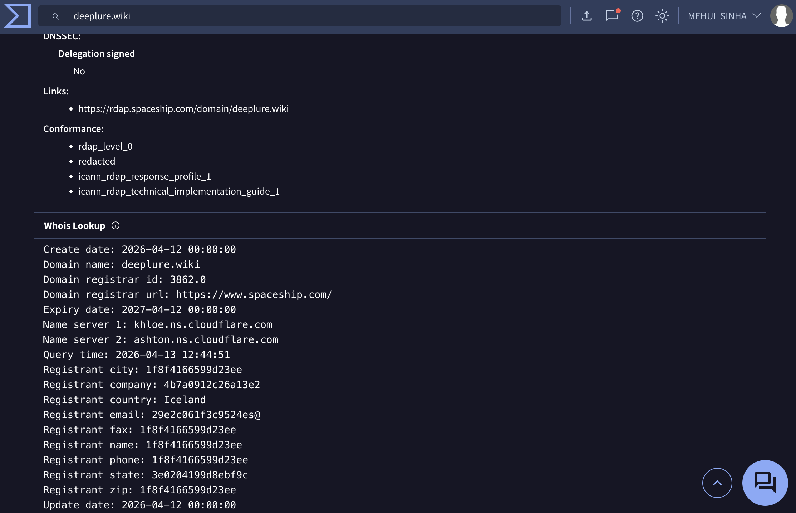

# Case 04 – Fake UnitedHealthcare "free dental kit" email from the same server as case 03

**Date analysed:** 2026-11-20   **Analyst:** Mehul Sinha
**Verdict:** Malicious (phishing / scam)   **Severity:** Medium

## 1. Summary
An email received on 18 Nov 2026 pretends to come from UnitedHealthcare, a large US health insurer, and announces a free Oral-B dental kit with a "confirmation code". It was sent from the same server as case 03, seven hours earlier, and uses the same Google Cloud Storage redirector and the same TinyURL link. Only the brand and the hidden Return-Path domain changed. That domain, `deeplure[.]wiki`, was registered in April 2026 and has an SPF record that allows any OVH server to send mail as it, which explains the SPF pass.

## 2. Header analysis
| Field | Value | Observation |
|---|---|---|
| From | `United-Healthcare® <contact@68116ajntk[.]us>` | Brand impersonation. Same pattern as case 03 (`contact@68116tXjnK[.]us`), including the same number 68116. |
| Return-Path | `return+<victim>@deeplure[.]wiki` | A different, new domain (see below). |
| Subject | "Pack Up – Your Free Oral-B Dental Kit Ready, confirmation code: 12567 ✔" | Reward lure with a fake confirmation code. |
| Date | Wed, 18 Nov 2026 05:46:20 +0100 | Case 03 was sent the same day at 12:37. |
| Message-Id | `<ERIqWan.12567.024.gUj@ajntk[.]us>` | Contains the same "code" 12567 as the subject, so it is tracking data. No encoded email address this time. |
| Sending IP | `135.125.103.187` | The exact server that sent case 03 (`vps-e8f7d3d6.vps.ovh[.]net`). |

### Authentication results
| Check | Result | Meaning |
|---|---|---|
| SPF | pass, for `deeplure[.]wiki` | Passed for the hidden Return-Path domain only. |
| DKIM | none | No DKIM-Signature header from the sender. |
| DMARC | none recorded | No alignment check for the visible From domain. |

### Why SPF passed
SPF record of `deeplure[.]wiki` (`dig TXT`):

```
v=spf1 include:spf.protection.outlook.com ptr:ovh.net ptr:ovh.ca ptr:ovh.us -all
```

Any server whose reverse DNS ends in `ovh.net`, `ovh.ca` or `ovh.us` may send mail as this domain. The sending server is an OVH VPS, so it passes. The domain also carries a Microsoft 365 verification record (`MS=ms36316457`); its purpose was not investigated.

Difference from case 03: `digiteka[.]com` is an established company whose broad SPF rule was most likely a careless setting. `deeplure[.]wiki` shows no sign of a real business, so this rule may have been written deliberately to let any rented OVH server pass.

### The Return-Path domain (VirusTotal / Whois)
- Created **12 April 2026**, expires 12 April 2027 (a one-year registration).
- Registrar: Spaceship. Name servers: Cloudflare.
- Registrant details are redacted (shown as hashes), country listed as Iceland.
- VirusTotal: 0/92.

## 3. Social engineering
- Lure: a free health product from a health insurer.
- Fake legitimacy: a "confirmation code" and a check mark in the subject.
- Same theme as the "Medicare kit" scam that AbuseIPDB reports linked to the case 02 server: free health kits appear to be a recurring lure.

## 4. URLs (defanged)
| URL | Finding |
|---|---|
| `hxxps://storage.googleapis[.]com/kdp000/makf.html#cl/69103_md/1/6665/3175/46041/68116` | Same redirector as cases 01 and 03 |
| `hxxps://storage.googleapis[.]com/kdp000/makf.html#oop/...` | Same page, probably a fake unsubscribe |
| `hxxps://tinyurl[.]com/4fnrcsdf/op/...` | Same short link as case 03 |

Rechecked on 20 Nov 2026:
- The redirector still sends victims to `000-email-kipb[.]store` (still live seven days after case 01).
- The TinyURL still points to `hxxp://82.39.186.49`.

The tracking path differs from case 03 only in some numbers (`69103` vs `69126`, `3175` vs `3906`), which likely identify the offer or brand, while `46041` and `68116` stay the same.

## 5. Link with cases 01 and 03
| | Case 01 | Case 03 | Case 04 |
|---|---|---|---|
| Brand | Cloud storage | Netflix | UnitedHealthcare |
| Lure | Fear | Fear | Reward |
| Sender | `contact@125223ubJQO[.]us` | `contact@68116tXjnK[.]us` | `contact@68116ajntk[.]us` |
| Return-Path | `livesight[.]net` | `digiteka[.]com` | `deeplure[.]wiki` |
| Sending IP | `135.125.102.246` (OVH) | `135.125.103.187` (OVH) | `135.125.103.187` (OVH) |
| Redirector | `kdp000/makf.html` | same | same |
| Destination | `000-email-kipb[.]store` | same + TinyURL → `82.39.186.49` | same + same TinyURL |

Conclusion: one campaign running several brands and lures in parallel from the same small set of OVH servers, rotating the sender and Return-Path domains while reusing the same redirector.

## 6. Attachments
None (`filename=` not found).

## 7. Indicators of Compromise (IOCs)
- Sender domain: `68116ajntk[.]us` (Message-Id domain `ajntk[.]us`)
- Return-Path domain: `deeplure[.]wiki` (created 2026-04-12)
- Sending IP: `135.125.103.187`
- Redirector: `storage.googleapis[.]com/kdp000/makf.html`
- Destinations: `000-email-kipb[.]store`, `82.39.186.49`
- Short link: `tinyurl[.]com/4fnrcsdf`

## 8. MITRE ATT&CK
- T1566.002 Phishing: Spearphishing Link
- T1204.001 User Execution: Malicious Link
- T1583.001 Acquire Infrastructure: Domains
- T1583.003 Acquire Infrastructure: Virtual Private Server
- T1583.006 Acquire Infrastructure: Web Services
- T1036 Masquerading (UnitedHealthcare brand)

## 9. Recommended actions
- Block `135.125.103.187` at the email gateway: it sent at least two different campaigns.
- Block `deeplure[.]wiki` and the destinations listed above.
- Search mailboxes for "United-Healthcare", "Dental Kit" and any email linking to `kdp000/makf.html` or `tinyurl[.]com/4fnrcsdf`.
- Report the redirector to Google Cloud abuse, the short link to TinyURL, and the sending server to OVH abuse.

## 10. Limitations
- The final pages were not visited.
- The link with cases 01 and 03 is based on shared infrastructure and patterns, not confirmed attribution.
- Registrant details for `deeplure[.]wiki` are redacted, so ownership could not be confirmed.

## 11. Lessons learned
- The strongest finding came from correlation: the same server sent two different brands on the same day.
- Rotating Return-Path domains (livesight, digiteka, deeplure) while keeping one redirector is how this campaign avoided domain blocklists; blocking the shared infrastructure is more effective than blocking each domain.
- Every reputation check on this email returned clean (0/92), yet the campaign was obvious once compared with earlier cases.

## 12. Evidence

**Terminal: headers, links, SPF record, TinyURL destination and redirector**


**deeplure.wiki on VirusTotal (0/92)**


**deeplure.wiki Whois (created 2026-04-12)**

